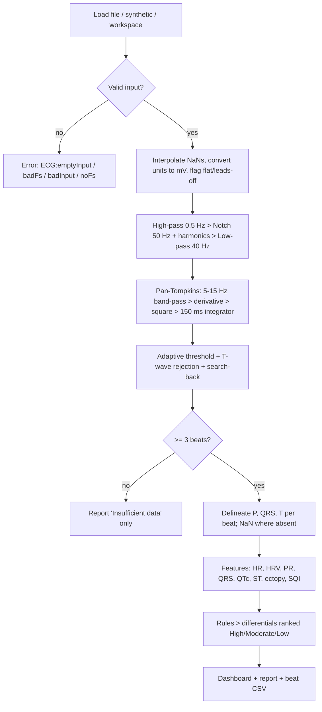

# ECG Analyser — EE22005 Project Week 1 (Group 24)

**The Puzzling Physiology:** a MATLAB program that takes a single-lead ECG, removes noise, finds the P-QRS-T features, measures rate, intervals and HRV, suggests a list of differential diagnoses and shows the results on a one-page dashboard.

Group 24: afb48, fjc48, owas20, aedg20, lhs53, ke417

> Educational use only. This is a rule-based screen of a single lead. It is not a medical device, and it cannot be used to diagnose or treat anyone.

## Quick start
1. Open `ECG_Analyser.m` in MATLAB.
2. In the **USER SETTINGS** block, set `source`:
   - `'synthetic:pvc'` (or `normal`, `brady`, `tachy`, `af`, `avb1`, `avb2`, `longqt`, `stelev`, `stdep`, `wideqrs`, `pause`, `vt`): a built-in test signal.
   - `'select'`: pick a recording in a file dialog.
   - `'C:\...\my_ecg.csv'`: one particular file.
   - A folder path: batch-analyse every recording in it.
   - `'demo'`: batch-analyse all 13 synthetic rhythms.
3. If your file has **no time column**, set `cfg.fs` to the sampling rate.
4. Press **Run**. The results print in the Command Window. A dashboard figure opens, and the report, beat table and PNG are saved in `ECG_outputs/`.

You **don't need any toolboxes**. The filters, spectrum and peak detector are all written from first principles. The code also runs in GNU Octave.

## Recording from the kit (Nano ESP32 + AD8232)
1. Wire the AD8232 to the Nano ESP32: GND to GND, **3.3V to 3V3**, OUTPUT to A0, LO+ to D10, LO- to D11.
2. Upload `Firmware/ECG_NanoESP32/ECG_NanoESP32.ino` (board: *Arduino Nano ESP32*). The sketch samples at 500 Hz and sends `time_us,ecg_V` lines over USB.
3. **Close the Arduino Serial Monitor**, because only one program can use the port.
4. In `ECG_Analyser.m`, set `source = 'capture';` (optionally set `cfg.capturePort = 'COM5'` and `cfg.captureSeconds = 60`) and press Run.
5. A live 5-second trace opens so you can check the electrodes. The title turns red if a lead comes off, and closing the window stops the recording early.
6. The recording is saved as `recordings/ECG_yyyymmdd_HHMMSS.csv` and analysed straight away. To analyse it again later, use `source = 'select'`.

Live capture needs MATLAB R2019b or later (`serialport`). Run the laptop on battery while electrodes are attached.

## Supported data
| Source | Format | What the program does |
|---|---|---|
| SparkFun AD8232 + Arduino (Serial log) | `.csv`/`.txt`: `time_ms,value` or `value` | Detects millis()/micros()/seconds. Resamples jittery timing. Counts `!` leads-off lines. Converts ADC counts to mV (10-bit, 5 V, gain 1100) |
| MATLAB Signal Simulator / PhysioNet | `.mat` or `.csv` in mV | Uses the longest vector in the file and reads an `fs`/`Fs` variable if present |
| Workspace variable | `res = ecg_analyse(x, fs)` | Same pipeline |

If the AD8232 gain or the Arduino reference voltage is different, change `cfg.frontEndGain`, `cfg.adcVref` and `cfg.adcBits` in `ECG_Analyser.m`.

## Program structure
```
ECG_Analyser.m          main script (user settings, single or batch run, live capture)
src/
  ecg_capture.m         record from the Nano ESP32 over USB serial, live view, save CSV
  ecg_capture_parse.m   split the serial stream into valid CSV lines (unit-tested)
  ecg_config.m          every parameter and clinical threshold in one place
  ecg_run_source.m      load a file or make a synthetic signal, then analyse
  ecg_load.m            CSV/TXT/MAT reader (time column, fs, jitter, leads-off)
  ecg_analyse.m         CORE PIPELINE: validate > units > filter > detect > delineate > features > diagnose
  ecg_units.m           counts / V / mV conversion
  ecg_preprocess.m      0.5 Hz high-pass, 50/100/150 Hz notch, 40 Hz low-pass (zero-phase)
  ecg_biquad.m          2nd-order IIR filter design (RBJ formulae)
  ecg_filtfilt.m        zero-phase forward-backward filtering
  ecg_psd.m             Welch power spectrum
  ecg_detect_r.m        Pan-Tompkins R-peak detector (adaptive thresholds, T-wave rejection, search-back, polarity check)
  ecg_delineate.m       P onset/peak, Q, QRS on/off, S, T peak/end (tangent method), ST level
  ecg_features.m        HR, RR/HRV, PR, QRS, QT, QTc, amplitudes, ectopic beats, signal-quality index
  ecg_diagnose.m        rule-based differential list (likelihood, evidence, possible causes)
  ecg_plot.m            7-panel dashboard with usernames in the footer
  ecg_report.m          text report, beat-by-beat CSV, PNG
  ecg_batch.m           analyse many recordings and write a comparison table
  ecg_summary_text.m    shared text formatting
  ecg_synth.m           synthetic ECG generator with known ground truth (for testing)
tests/
  run_tests.m           29-case verification test plan, writes test_results.csv
```

## Processing flow


## Key decision thresholds (in `ecg_config.m`)
| Finding | Rule |
|---|---|
| Sinus brady / tachy | P waves present, HR < 60 / > 100 bpm |
| Atrial fibrillation | normalised RMSSD > 0.12 **and** P waves in < 60 % of beats or PR SD > 40 ms |
| First-degree AV block | PR > 200 ms |
| Pre-excitation | PR < 120 ms |
| Wide QRS / BBB | QRS ≥ 120 ms (the ST and QT rules are switched off for wide beats) |
| Long / short QT | QTc > 450 ms (male/unknown) or > 460 ms (female); > 500 ms is high risk; < 350 ms is short. Bazett is used at 50–90 bpm and Fridericia outside that range |
| ST elevation / depression | ≥ +0.10 mV / ≤ −0.05 mV at J+60 ms (J+40 ms when RR < 0.5 s) |
| PVC | RR < 0.8 × local median **and** (QRS ≥ 120 ms or template correlation < 0.8) |
| Pause / dropped beat | RR > 2 s / RR ≈ 2 × median |

## Verification
Run `tests/run_tests.m`. The suite covers 14 nominal rhythms, 4 boundary conditions (HR exactly 60 vs 58 bpm, fs = 125 Hz, very heavy noise), 5 edge cases (inverted leads, flat line, 1.5 s record, 5 % NaN dropouts, a realistic Arduino CSV) and 5 error-handling cases, plus a test of the live-capture serial parser. **Current result: 29 / 29 pass** (see `tests/test_results.csv`).

## Known limitations
- Single lead: the program can't localise an infarct or tell LBBB from RBBB.
- The P-wave detector assumes upright P waves, as seen in a lead-II-like placement.
- The ground truth for testing is synthetic. Validating on real recordings, e.g. the MIT-BIH database, is the next step.

## References
- J. Pan and W. J. Tompkins, "A real-time QRS detection algorithm," *IEEE Trans. Biomed. Eng.*, vol. 32, no. 3, pp. 230–236, 1985.
- P. E. McSharry *et al.*, "A dynamical model for generating synthetic electrocardiogram signals," *IEEE Trans. Biomed. Eng.*, vol. 50, no. 3, pp. 289–294, 2003.
- Task Force of the ESC/NASPE, "Heart rate variability: standards of measurement," *Circulation*, vol. 93, pp. 1043–1065, 1996.
- R. Bristow-Johnson, "Cookbook formulae for audio EQ biquad filter coefficients" (W3C Audio EQ Cookbook).
- SparkFun Electronics, "AD8232 Heart Rate Monitor Hookup Guide."
